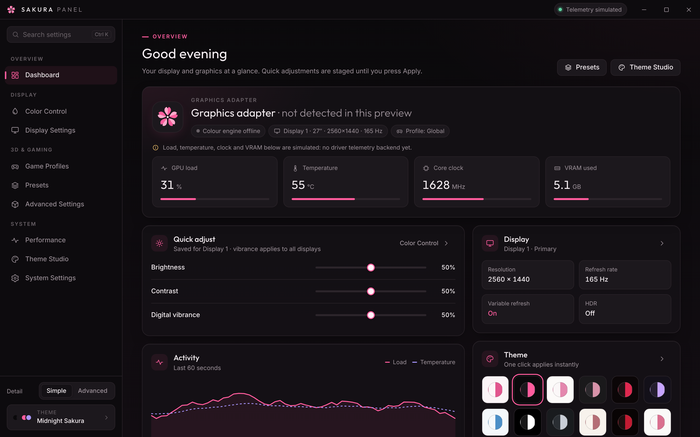
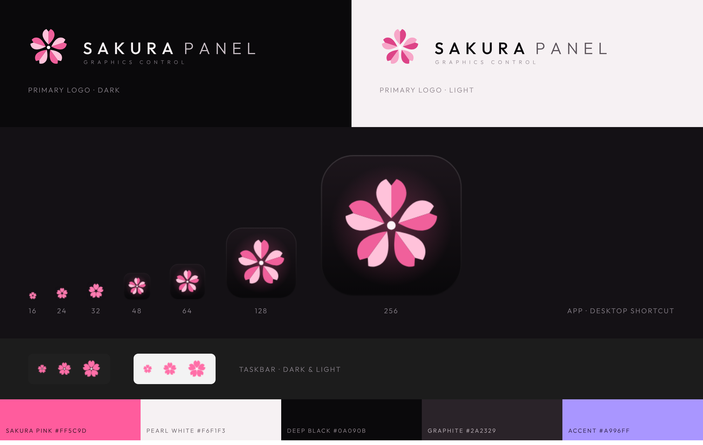

# SAKURA PANEL

A graphics control panel for Windows, styled after Japanese cherry blossoms.



> **Status:**
> - **Display colour is real.** On Windows, Color Control and Presets change what your monitors show, through documented Windows APIs (see [Display colour engine](#display-colour-engine)).
> - **Not connected yet:** 3D settings, display modes, game profiles, power/fan/clock controls, and GPU telemetry (simulated). Each of those pages says so, and Apply reports them as "saved, not applied".

## Install (Windows)

**One line in PowerShell:**

```powershell
irm https://raw.githubusercontent.com/tfem1/sakura-panel/main/install.ps1 | iex
```

What the command does:
1. Uses Git and Node.js if they're installed. Otherwise it installs them with winget, or, if winget is missing or fails, downloads private portable copies. Either way you don't need to restart or re-run anything.
2. Clones the repo into `%LOCALAPPDATA%\SakuraPanel`.
3. Runs `npm install`.
4. Creates **SAKURA PANEL** shortcuts on the Desktop and in the Start menu.
5. Launches the app.

Run the same command again to update (it does a `git pull`). To uninstall:

```powershell
irm https://raw.githubusercontent.com/tfem1/sakura-panel/main/uninstall.ps1 | iex
```

**With git clone:**

```bash
git clone https://github.com/tfem1/sakura-panel.git
cd sakura-panel
npm install
npm start            # Electron window (native caption buttons, tray, taskbar icon)
```

`npm run dist` builds a Windows installer (NSIS) with desktop and Start-menu shortcuts.

The UI also runs on its own: open `src/index.html` in Chromium or Edge.

```bash
npm test                     # colour maths + engine unit tests, UI e2e, full UI -> engine chain (simulated Windows)
npm run test:display         # Windows only: drives your REAL displays and verifies each change by read-back
npm run test:win32           # Windows only: low-level probe of every Win32 call (restores what it changes)
npm run test:electron        # launches the real Electron app and checks preload -> IPC -> engine
npm run brand                # regenerate every logo / icon / .ico from scripts/brand.js
node scripts/showcase.js     # regenerate docs/screenshots and the brand sheet
```

## Brand identity



The mark is a geometric blossom with five petals. Each petal has the cherry-blossom notch and is split into a light facet and a deep facet, which gives a folded, origami look. A negative-space core sits in the middle. Every asset is generated from one parametric definition in `scripts/brand.js`. The wordmark is converted to outlines, so the logo files don't need a font installed.

| Asset | File |
|---|---|
| Full logo (dark / light, horizontal / stacked) | `assets/brand/sakura-logo-*.svg` |
| Mark (colour / mono `currentColor`) | `assets/brand/sakura-mark*.svg`, `sakura-mark-1024.png` |
| Application icon: tile, 16–256 px. Sizes 16–32 px use a heavier glyph made for small sizes | `assets/icons/sakura-panel.ico`, `app-icon-*.png`, `app-icon.svg` |
| Desktop shortcut icon | `assets/icons/desktop-shortcut.ico` (installer shortcuts use the exe icon, which is the same file) |
| Windows taskbar icon (transparent, reads on dark and light taskbars) | `assets/icons/taskbar.ico`, `taskbar-icon-*.png` |

Typography: **Outfit** for display and wordmark, **Inter** for UI text. Both are bundled under the SIL OFL (`src/fonts/`). Base palette: Sakura pink `#FF5C9D`, pearl white `#F6F1F3`, deep black `#0A090B`, graphite `#2A2329`, soft-violet accent `#A996FF`. Pink is kept for active states and highlights. Surfaces stay neutral.

Inside the app the blossom is drawn inline. Its two facets come from the active theme, so the mark is grey and white in *Black & White* and blue in *Ice Sakura*.

## Themes

There are 12 built-in themes. **Midnight Sakura** is the default.

Sakura Pink · Midnight Sakura · Pure Sakura · Dark Blossom · Crimson Sakura · Lavender Sakura · Ice Sakura · Black & White · Graphite · Rose Gold · Deep Red · Minimal Sakura

A theme is a flat set of tokens (`src/js/themes.js` → `SP.TOKEN_SCHEMA`):

- **Brand:** primary, secondary, accent
- **Surfaces:** background, background gradient, sidebar, panel, raised panel, panel opacity
- **Text and lines:** text, muted text, borders
- **Controls:** button, button text, slider track / fill / thumb
- **Effects:** hover tint and strength, animation colour, glow intensity

`theme-engine.js` turns these tokens into CSS variables, including derived ones such as soft fills, focus rings and shadows. Every page uses only those variables, so each theme looks the same across all nine pages.

**Theme Studio** lets you:
- browse every theme, preview it (click) and apply it (double-click or **Apply theme**)
- customise every token, with a live preview and an optional live preview across the whole app
- pick a quick sakura or monochrome accent
- see a low-contrast warning while editing
- create, duplicate, delete, rename and save themes
- edit a built-in theme (saved as an override you can reset)
- import and export `.sakura-theme.json` files (validated, max 64 KB)
- restore the default theme

The active theme is saved and painted before the first frame on the next launch. In Electron, the native caption buttons and the window background are recoloured to match.

Theme file format:

```json
{ "format": "sakura-panel-theme", "version": 1, "name": "My Sakura", "mode": "dark",
  "tokens": { "primary": "#FF5C9D", "background": "#0A090B", "panelOpacity": 0.94, "...": "..." } }
```

## Pages

| Page | What it covers |
|---|---|
| Dashboard | Status, quick adjustments, activity, display summary, one-click theme switch, profiles |
| Color Control | **Live.** Per-display tone and RGB (gamma ramp) and global saturation/vibrance/hue (colour matrix). Includes real A/B compare, Restore original, live status with read-back verification, and a self-test |
| Display Settings | Real monitor list and current mode. Changing modes, VRR, HDR and scaling is *not connected yet* |
| Game Profiles | Per-program overrides are saved. Automatic switching is *not connected yet* |
| Presets | **Live.** Six built-in looks plus your own. Applying one changes the selected display immediately |
| Advanced Settings | 3D settings are saved only. Driver profiles (NVAPI DRS / ADLX) are *not connected yet* |
| Performance | Telemetry is simulated. Power, fan and clock controls are *not connected yet* |
| Theme Studio | See above |
| System Settings | Startup, tray, start page, detail level, animation level, UI scale, export/reset, about |

**UX:**
- **Simple / Advanced** detail switch: Simple hides expert controls.
- Settings search (**Ctrl K**): finds hidden controls and highlights them.
- Hardware-style settings are staged. A modified dot marks each changed row, and an **Apply / Discard** bar appears (Ctrl Enter applies).
- UI preferences apply instantly.

**Motion:** page fades, a sliding nav indicator, animated slider fills, spring toggles, expanding sections, toasts, an "applied" flash, a themed splash and theme crossfades. Animations use transform, opacity and colour only: no blur, no particles. Animation levels are Full / Reduced / Off, and the app respects `prefers-reduced-motion`. Telemetry updates once a second and pauses when no page is watching it.

## Display colour engine

Windows offers no single API that does every colour adjustment system-wide. SAKURA PANEL uses the two documented mechanisms that do work, each only for what it can really do.

| Stage | Windows API | Scope | Settings |
|---|---|---|---|
| Hardware gamma ramp | `SetDeviceGammaRamp` / `GetDeviceGammaRamp` (GDI): the GPU's output lookup table | **Per display.** Everything on screen, including most full-screen games | Brightness, contrast, gamma, colour temperature, exposure, shadows, highlights, black level, white level, RGB gain / offset / gamma |
| Colour matrix | `MagSetFullscreenColorEffect` (Magnification API): a 5×5 matrix applied by the desktop compositor | **All displays.** Desktop, windowed and borderless apps and games. Exclusive full-screen games and protected video can bypass it | Saturation, digital vibrance (as a *linear* saturation boost), hue |
| Not offered | none | none | **Sharpness**: needs a spatial filter, and no system-wide API exists. **Output depth / format / range**: need the NVIDIA or AMD driver API (shown read-only) |

How it works:

- **Live:** dragging a slider sends the change to the main process. Updates are coalesced so Windows gets at most about 60 per second. **Apply** re-applies, verifies and saves; **Discard** restores the previous values; **Hold to compare** shows the real original output.
- **Calibration preserved:** adjustments are composed on top of each monitor's existing ramp, so neutral settings give back your calibration exactly.
- **Verified:** every commit reads the ramp and matrix back from Windows. Each display shows *Active · verified*, *Limited by Windows*, *Overridden by another program*, *Unavailable* (for example HDR on, where Windows ignores gamma ramps) or *Failed*. A failure is never reported as success.
- **Windows' limit:** Windows refuses gamma ramps that move too far from neutral. When that happens, the strongest accepted version is applied and labelled *Limited by Windows (x%)*.
- **Safety:**
  - Each monitor's original ramp is backed up before the first change.
  - A session lock plus a watchdog (the same `electron.exe` in Node mode, no PowerShell) restore the originals if the app crashes; the check also runs again at the next launch.
  - **When SAKURA PANEL quits** (System Settings): *Restore colours* (default), or *Keep gamma*. The colour matrix always ends with the process.
  - Monitor connect/disconnect, resolution/refresh/rotation changes, resume and unlock all trigger a re-enumeration and a verified re-apply.
- **Not used:** vendor APIs (NVAPI, ADLX) and undocumented driver calls.

## Structure

```
electron/         main.js (window, caption overlay, tray, single instance, colour IPC, self-test CLI), preload.js
electron/color/   win32.js (koffi bindings: GDI, DisplayConfig, Magnification), engine.js, watchdog.js, selftest.js
src/              index.html, css/, js/ (color-math.js shared with main, color-bridge.js, state, theme engine, ui, pages/)
assets/           brand/ and icons/ (generated)
scripts/          brand.js, showcase.js, run-display-selftest.js
tests/            color-math / color-engine unit tests, e2e.js, electron-bridge.js (UI -> real engine -> simulated Windows),
                  electron-ipc.js (real Electron), win32-probe.js (real Win32 calls)
```
